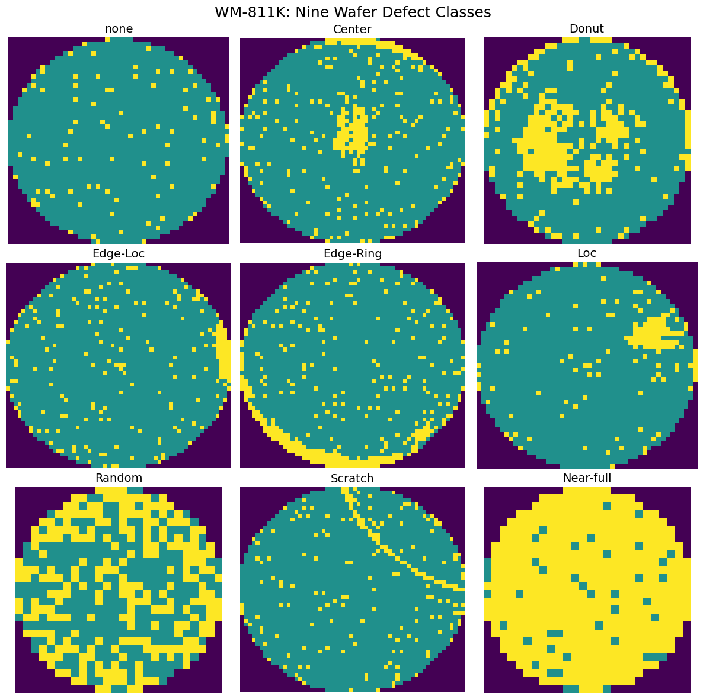
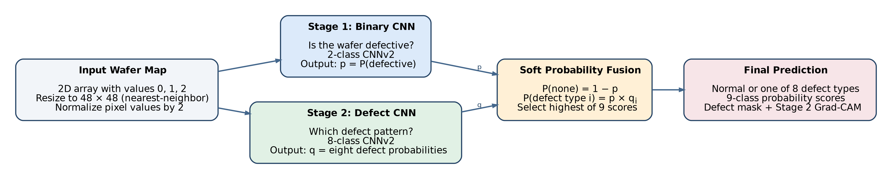

# WaferVision AI

## Intelligent Wafer Defect Detection and Classification from Wafer Maps

WaferVision AI is an end-to-end deep learning project for **semiconductor wafer-map defect classification**. The project starts from raw wafer-map arrays, performs data cleaning and leakage-aware splitting, experiments with multiple model designs, and ends with a **two-stage hierarchical CNN system** plus a **Streamlit application** for interactive inference.

This repository is written to be understandable even if you have **zero background in semiconductor manufacturing**.

---

## Table of Contents

1. [Problem Statement](#1-problem-statement)
2. [What Is a Wafer Map?](#2-what-is-a-wafer-map)
3. [Project Goal](#3-project-goal)
4. [Dataset](#4-dataset)
5. [Class Labels](#5-class-labels)
6. [Example Wafer Visualizations](#6-example-wafer-visualizations)
7. [Data Preparation and Experimental Design](#7-data-preparation-and-experimental-design)
8. [Preprocessing Pipeline](#8-preprocessing-pipeline)
9. [Model Development Journey](#9-model-development-journey)
10. [Final Selected Architecture](#10-final-selected-architecture)
11. [Results and Model Comparison](#11-results-and-model-comparison)
12. [Held-Out Test Performance](#12-held-out-test-performance)
13. [Explainability and Output Visualizations](#13-explainability-and-output-visualizations)
14. [Streamlit Application](#14-streamlit-application)
15. [How to Run the Project](#15-how-to-run-the-project)
16. [Key Learnings and Limitations](#16-key-learnings-and-limitations)
17. [Tech Stack](#17-tech-stack)

---

## 1. Problem Statement

Semiconductor chips are manufactured on circular silicon discs called **wafers**. Each wafer contains many small chip locations, called dies. During inspection and electrical testing, some dies pass and some fail.

A **wafer map** is a compact 2D representation of those die outcomes. Certain spatial failure patterns can reveal useful information. For example:

- failures concentrated near the edge,
- failures concentrated at the center,
- random failures,
- line-like scratch patterns,
- almost fully failed wafers.

Traditionally, these patterns can be reviewed manually, but manual review is time-consuming, inconsistent, and difficult to scale.

### The machine learning problem

Given a wafer map, predict whether it is:

- **Normal (`none`)**, or
- one of **8 defect pattern classes**:
  - Center
  - Donut
  - Edge-Loc
  - Edge-Ring
  - Loc
  - Random
  - Scratch
  - Near-full

So the final task is a **9-class classification problem**.

---

## 2. What Is a Wafer Map?

In this project, each wafer is stored as a **2D categorical array** with values:

| Value | Meaning |
|---|---|
| `0` | Outside wafer area |
| `1` | Normal / non-defective die |
| `2` | Defective die |

For visualization, we display them as:

- **purple** → outside wafer,
- **teal** → normal die,
- **yellow** → defective die.

So this project does **not** classify raw microscope photographs. Instead, it classifies already-generated wafer-map grids.

---

## 3. Project Goal

The goal of this project is to build a practical AI system that can:

1. **detect whether a wafer is normal or defective**, and
2. **classify defective wafers into the correct defect pattern category**.

In addition to building a strong classifier, the project also focuses on:

- proper dataset cleaning,
- leakage-aware evaluation,
- comparison of multiple modeling strategies,
- explainability using Grad-CAM,
- and a deployable **Streamlit app**.

---

## 4. Dataset

We used the **WM-811K** wafer map dataset.

### Raw dataset summary

| Property | Value |
|---|---:|
| Total records | 811,457 |
| Original columns | 6 |
| Labeled records used for supervised learning | 172,950 |
| Unlabeled records excluded from supervised training | 638,507 |
| Number of final classes | 9 |

### Original dataframe columns

- `waferMap`
- `dieSize`
- `lotName`
- `waferIndex`
- `trianTestLabel`
- `failureType`

After cleaning, we created a simplified label column and used only the **labeled** subset.

---

## 5. Class Labels

The labeled dataset distribution after cleaning was:

| Class | Count |
|---|---:|
| none | 147,431 |
| Edge-Ring | 9,680 |
| Edge-Loc | 5,189 |
| Center | 4,294 |
| Loc | 3,593 |
| Scratch | 1,193 |
| Random | 866 |
| Donut | 555 |
| Near-full | 149 |

### Important observation: class imbalance

This is a **highly imbalanced dataset**.

- `none` dominates the dataset.
- minority classes like `Near-full`, `Donut`, `Random`, and `Scratch` are much rarer.

Because of this, **accuracy alone is not enough**. We also tracked:

- **Macro F1-score**,
- per-class precision / recall / F1,
- confusion matrices,
- and failure cases.

---

## 6. Example Wafer Visualizations

Below are example wafer maps from the nine classes.



### Intuition behind the classes

| Class | Description |
|---|---|
| none | No obvious systematic defect pattern |
| Center | Defects concentrated near the center |
| Donut | Ring-like defect pattern |
| Edge-Loc | Localized defect cluster near an edge |
| Edge-Ring | Ring of defects around the boundary |
| Loc | Localized cluster inside one region |
| Random | Irregular scattered defects |
| Scratch | Line-like defect pattern |
| Near-full | Most dies are defective |

---

## 7. Data Preparation and Experimental Design

### 7.1 Cleaning steps

We removed unlabeled records and retained only records with valid defect labels.

| Stage | Shape |
|---|---:|
| Original dataset | 811,457 |
| Clean labeled dataset | 172,950 |

### 7.2 Why lot-aware splitting was necessary

Wafer maps come from many manufacturing lots. If wafers from the same lot appear in both training and validation/test sets, the model may benefit from hidden lot-specific similarities.

To avoid this, we split the data **by lot** using a leakage-aware strategy.

### 7.3 Final split

| Split | Samples | Percentage |
|---|---:|---:|
| Train | 103,312 | 59.74% |
| Validation | 35,145 | 20.32% |
| Test | 34,493 | 19.94% |

**No lot leakage was detected.**

This is one of the most important parts of the project because it makes the reported performance more trustworthy.

---

## 8. Preprocessing Pipeline

Wafer maps have many different original shapes.

### Original shape statistics

- Total unique image shapes: **346**
- Minimum height: **15**
- Maximum height: **212**
- Minimum width: **3**
- Maximum width: **204**

The most common shapes clustered around smaller dimensions such as `(25,27)`, `(26,26)`, `(30,34)`, `(39,37)`, etc.

### Why 48 × 48?

Instead of resizing to a very large size such as 64 × 64, we selected **48 × 48** because:

- most wafer shapes are relatively small,
- 48 × 48 preserves enough spatial structure,
- nearest-neighbor interpolation preserves categorical values,
- it reduces computational cost,
- it worked well empirically.

### Final preprocessing steps

For every wafer map:

1. take the original 2D wafer grid,
2. resize to **48 × 48** using **nearest-neighbor interpolation**,
3. map values from `{0,1,2}` to `{0.0, 0.5, 1.0}` by dividing by 2,
4. convert to `float32`,
5. add a single input channel.

So each model input becomes:

- **shape:** `1 × 48 × 48`
- **dtype:** `float32`
- **value range:** `[0.0, 1.0]`

---

## 9. Model Development Journey

We did not directly jump to the final solution. Instead, we ran a sequence of experiments and compared them carefully.

### 9.1 Baseline model — WaferCNN (9-class)

The first model was a simple CNN for direct 9-class classification.

**Architecture summary**
- 3 convolution blocks,
- ReLU activations,
- max pooling,
- flatten + dense classifier,
- output size = 9.

**Trainable parameters:** 683,785

This model established the initial baseline and confirmed that the task is learnable.

### 9.2 Baseline training with class weights and early stopping

We used:
- weighted `CrossEntropyLoss`,
- Adam optimizer,
- early stopping,
- validation monitoring using Macro F1.

**Best validation Macro F1:** **0.8446**

### 9.3 Data augmentation experiment

We applied augmentation mainly to strengthen underrepresented defect patterns, especially `Scratch`.

**Best validation Macro F1:** **0.8435**

This did not outperform the best baseline.

### 9.4 Weighted sampling experiment

We tried `WeightedRandomSampler` to sample minority classes more frequently.

**Best validation Macro F1:** **0.8373**

This also did not beat the best earlier result.

### 9.5 Improved compact model — WaferCNNv2 (9-class)

We then designed a stronger and more regularized CNN.

**Architecture characteristics**
- 6 convolutional layers,
- Batch Normalization,
- ReLU activations,
- 3 max-pooling stages,
- Adaptive Average Pooling,
- small MLP head,
- dropout = 0.4.

**Trainable parameters:** **296,169**

This model is much smaller than ResNet18 while still being expressive enough for the task.

**Validation Macro F1:** **0.8386**

### 9.6 WaferCNNv2 + learning-rate scheduler

We then added a learning-rate scheduler to improve convergence.

This became the best **single-model** approach.

**Validation results**
- Accuracy: **0.9727**
- Macro F1: **0.8620**
- Scratch Recall: **0.5823**

Training curves for this run are shown below.


### 9.7 ResNet18 experiment

We also trained a 9-class **ResNet18** by adapting it to 1-channel input.

**Validation results**
- Accuracy: **0.9687**
- Macro F1: **0.8497**
- Scratch Recall: **0.7108**

ResNet18 improved Scratch recall, but overall Macro F1 remained below the best CNNv2 + scheduler model.

### 9.8 Motivation for hierarchical classification

Even strong direct 9-class models still faced a fundamental issue:

- the `none` class was extremely dominant,
- defect classes were much rarer,
- the model sometimes struggled to balance “normal vs defective” and “which defect type?” within a single network.

So we designed a **two-stage hierarchical system**.

---

## 10. Final Selected Architecture

The final selected model is a **hierarchical CNNv2 + CNNv2 system**.

### Final architecture overview



### Stage 1 — Binary defect detector

The first model predicts:

- `Normal`
- `Defective`

This model answers the question:

> “Does this wafer look normal or defective?”

#### Binary training distribution

| Label | Count |
|---|---:|
| Normal (`none`) | 87,970 |
| Defective (all 8 defect classes combined) | 15,342 |

#### Binary classifier performance

**Validation results**
- Accuracy: **0.9810**
- Defective-class F1: **0.9332**
- ROC-AUC: **0.9951**
- Average Precision: **0.9812**

We also performed threshold analysis to study the precision–recall trade-off.


### Stage 2 — 8-class defect classifier

The second model is trained only on defective wafers.

It predicts one of the 8 defect classes:

- Center
- Donut
- Edge-Loc
- Edge-Ring
- Loc
- Random
- Scratch
- Near-full

#### Stage 2 validation performance

- Accuracy: **0.9272**
- Macro F1: **0.9007**

This specialist classifier worked better than forcing a single model to simultaneously learn the heavily dominant `none` class and the rarer defect classes.

### Soft probability fusion

At inference time:

- Stage 1 outputs `P(defect)`.
- Stage 2 outputs an 8-class conditional distribution `q` over defect types.

We compute the final 9-class probabilities as:

- **P(none) = 1 − P(defect)**
- **P(defect_i) = P(defect) × q_i**

This produces a final 9-class probability vector:

`[none, Center, Donut, Edge-Loc, Edge-Ring, Loc, Random, Scratch, Near-full]`

### Why this architecture was selected

This hierarchical soft-fusion approach produced the best validation Macro F1 among the candidate systems.

---

## 11. Results and Model Comparison

### Validation-set comparison of major experiments

| Model | Validation Accuracy | Validation Macro F1 | Scratch Recall |
|---|---:|---:|---:|
| WaferCNN baseline + early stopping | 0.9694 | 0.8446 | 0.4699 |
| WaferCNN + augmentation | 0.9685 | 0.8435 | 0.5181 |
| WaferCNN + weighted sampling | 0.9695 | 0.8373 | 0.4217 |
| WaferCNNv2 | 0.9703 | 0.8386 | 0.5703 |
| WaferCNNv2 + scheduler | 0.9727 | 0.8620 | 0.5823 |
| ResNet18 | 0.9687 | 0.8497 | 0.7108 |
| Hierarchical Hard (threshold = 0.05) | 0.9592 | 0.8406 | 0.6707 |
| Hierarchical Hard (threshold = 0.35) | 0.9723 | 0.8649 | 0.6265 |
| Hierarchical Hard (threshold = 0.50) | 0.9734 | 0.8659 | 0.5984 |
| **Hierarchical Soft Fusion (final selected)** | **0.9737** | **0.8664** | **0.5944** |
| CNNv2 + ResNet18 Soft Fusion | 0.9714 | 0.8468 | 0.5863 |

### Key takeaway

- The **best direct single model** was **CNNv2 + scheduler**.
- The **best overall model** was the **hierarchical CNNv2 + CNNv2 soft-fusion model**.
- ResNet18 improved Scratch recall but did not produce the best overall Macro F1.

---

## 12. Held-Out Test Performance

After model selection on the validation set, the final selected hierarchical system was evaluated once on the held-out test set.

### Final test metrics

| Metric | Value |
|---|---:|
| Accuracy | **0.9729** |
| Macro F1 | **0.8526** |
| Test samples | **34,493** |
| Scratch Recall | **0.5020** |

### Test classification report

| Class | Precision | Recall | F1-score |
|---|---:|---:|---:|
| none | 0.9844 | 0.9939 | 0.9891 |
| Center | 0.9120 | 0.9110 | 0.9115 |
| Donut | 0.8476 | 0.8900 | 0.8683 |
| Edge-Loc | 0.8257 | 0.7982 | 0.8117 |
| Edge-Ring | 0.9828 | 0.9682 | 0.9754 |
| Loc | 0.7834 | 0.6777 | 0.7267 |
| Random | 0.9399 | 0.8152 | 0.8731 |
| Scratch | 0.8129 | 0.5020 | 0.6207 |
| Near-full | 0.9630 | 0.8387 | 0.8966 |

### Confusion matrix


### Interpretation

The final model generalizes strongly overall, especially on:
- `none`,
- `Edge-Ring`,
- `Center`,
- `Near-full`.

However, some classes remain difficult:
- `Scratch` often gets confused with `none` or related patterns,
- `Loc` and `Edge-Loc` still show overlap,
- minority classes remain more challenging than majority classes.

This is why Macro F1 and per-class analysis were essential.

---

## 13. Explainability and Output Visualizations

To make the model more interpretable, we built two types of output visualization.

### 13.1 Defect mask

The input wafer already contains defective dies as value `2`.

So we generate a simple **defect pixel mask** by computing:

`wafer == 2`

This gives a clean visualization of actual defect locations.

### 13.2 Grad-CAM

We used **Grad-CAM** on the defect-classifier network to highlight image regions influencing the prediction.

Below is an example showing:
- original wafer,
- actual defect mask,
- Grad-CAM heatmap,
- overlay.


We also generated Grad-CAM examples across multiple classes:


### Important interpretability note

Grad-CAM explains **where the model focuses**. It does **not** prove physical root cause.

Also, in the hierarchical model, the Grad-CAM is produced from the **Stage 2 defect classifier**, so if the final fused label is `none`, the heatmap still reflects the defect-classifier's internal attention.

---

## 14. Streamlit Application

To make the project interactive, we built a **Streamlit application**.

### Streamlit app capabilities

The app allows a user to:

- select a built-in sample wafer,
- upload a `.npy` wafer-map file,
- view the original wafer,
- view the defect mask,
- view the Stage 2 Grad-CAM visualization,
- see the final predicted class,
- inspect Stage 1 defect probability,
- inspect all final 9-class prediction scores.

### Inference pipeline inside the app

1. Load wafer map.
2. Validate it is a 2D array containing only `0, 1, 2`.
3. Preprocess to `48 × 48`.
4. Run binary CNN.
5. Run defect-type CNN.
6. Fuse probabilities.
7. Display prediction + visual explanations.

This turns the project into a practical demo rather than only a notebook experiment.

---

## 15. How to Run the Project

### 15.1 Open the project locally

After downloading or cloning the repository to your machine, open a terminal in the project root directory.

### 15.2 Install dependencies

```bash
pip install -r requirements.txt
```

### 15.3 Run the Streamlit app

```bash
streamlit run app.py
```

### 15.4 Expected inputs

The app expects wafer maps stored as `.npy` files containing:

- a 2D array,
- categorical values `0`, `1`, and `2` only.

---

## 16. Key Learnings and Limitations

### Key learnings

1. **Data splitting matters.** Lot-aware splitting was critical.
2. **Accuracy is not enough.** Macro F1 and per-class recall were necessary because of severe class imbalance.
3. **A smaller model can outperform a larger one.** CNNv2 beat ResNet18 on the main selection metric.
4. **Hierarchical modeling helped.** Separating normal-vs-defective from defect-type recognition produced the best overall result.
5. **Explainability improved usability.** Defect masks and Grad-CAM made the outputs easier to inspect.

### Main limitations

1. **Scratch remains difficult.** Final test recall for Scratch was only **50.20%**.
2. **Class imbalance remains a challenge.** Very rare classes still have limited samples.
3. **Pattern classification is not physical root-cause analysis.** The model identifies spatial defect patterns, not process causes.
4. **The system works on wafer maps, not raw wafer images.**
5. **Grad-CAM is helpful but not perfect.** It provides attention-style explanations, not causal proof.

### Future improvements

- stronger minority-class handling,
- focal loss or label-distribution-aware loss,
- calibrated probability fusion,
- more advanced explainability,
- model ensembling,
- deeper study of Scratch errors.

---

## 17. Tech Stack

- **Python**
- **PyTorch**
- **NumPy**
- **pandas**
- **OpenCV**
- **scikit-learn**
- **Matplotlib / Seaborn**
- **Kaggle** (training and experimentation)
- **Streamlit** (interactive web application)

---

## Final Summary

WaferVision AI is a complete applied ML project that covers:

- problem understanding,
- data exploration,
- leakage-aware data splitting,
- preprocessing,
- multiple model experiments,
- model comparison,
- hierarchical deep learning,
- explainability,
- and deployment through Streamlit.

### Final selected model

**Hierarchical CNNv2 + CNNv2 with soft probability fusion**

### Final held-out test result

- **Accuracy:** **97.29%**
- **Macro F1:** **85.26%**

This project demonstrates not only model-building, but also the engineering and evaluation discipline required to build a reliable AI system for an industrial pattern-classification task.
