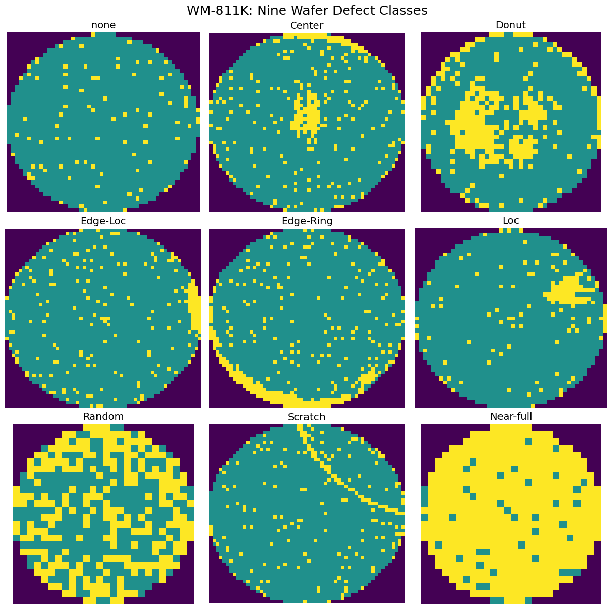
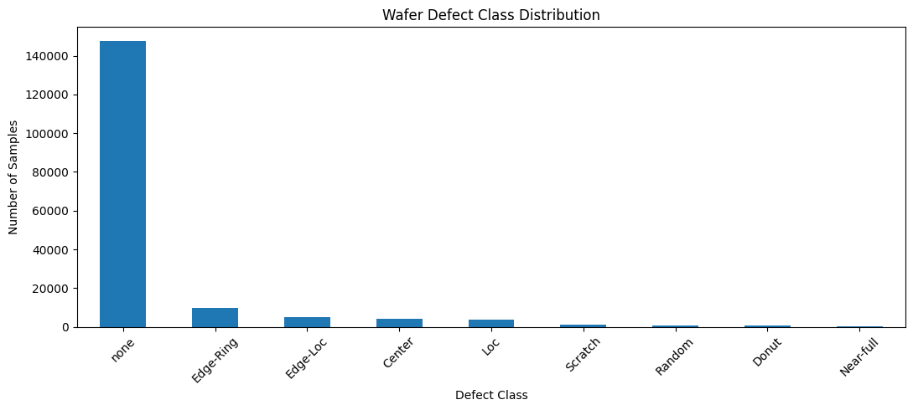
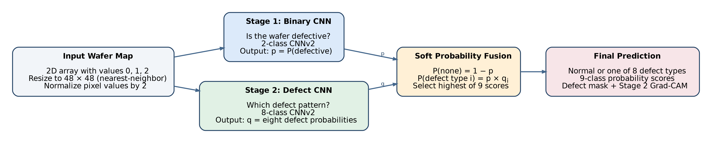
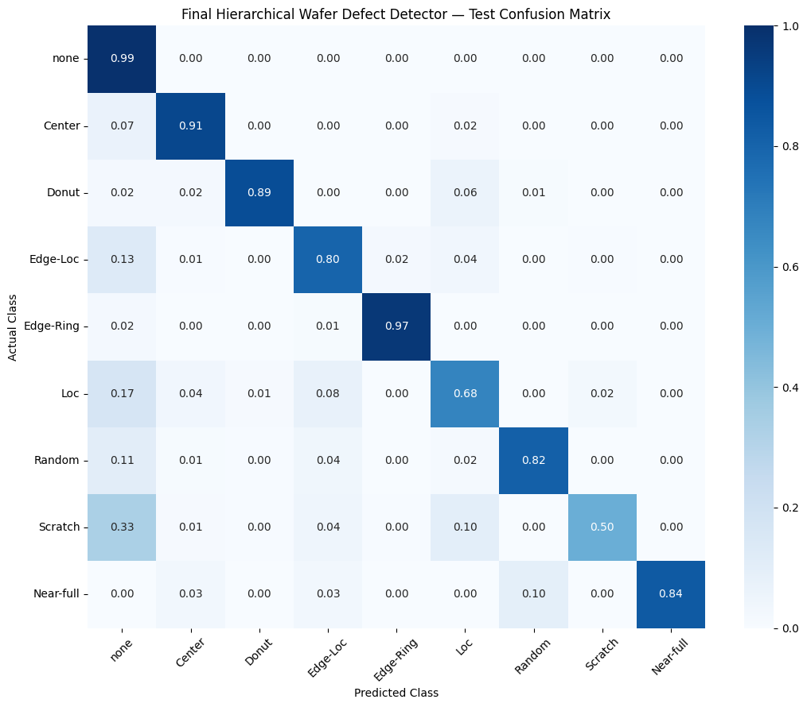
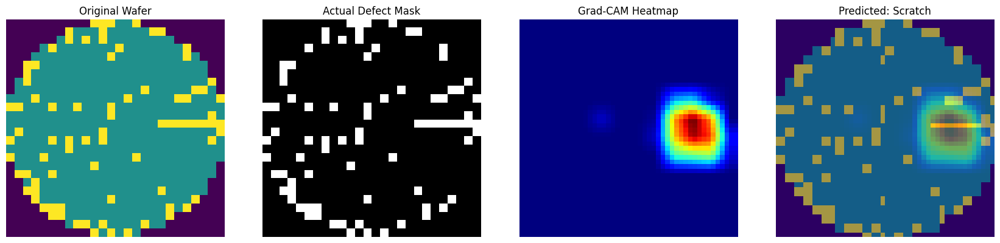

# WaferVision AI

**Explainable wafer-map defect detection using a two-stage deep learning model and a Streamlit app.**

WaferVision AI analyzes semiconductor **wafer maps**—2D grids showing which chip locations passed or failed testing—and predicts whether a wafer is normal or exhibits one of eight common defect patterns. The project covers data exploration, model experimentation, leakage-aware evaluation, visual explanations, and an interactive Streamlit interface.

### Final held-out test results

| Accuracy | Macro F1 | Test wafers | Classes |
|:--:|:--:|:--:|:--:|
| **97.29%** | **85.26%** | **34,493** | **9** |

> **Key limitation:** Scratch recall was **50.20%** on the test set. Strong overall accuracy does not mean every rare defect pattern is reliably detected.

## 1. The problem, explained simply

A silicon wafer contains many individual chip locations, called **dies**. After manufacturing, testing identifies dies that work and dies that fail. These results can form spatial patterns: failed dies may cluster at the center, near the edge, in a ring, or along a line resembling a scratch.

Instead of reviewing thousands of wafer maps manually, we train a model to recognize these patterns.

Each input is a **2D array**, not a photograph:

| Pixel value | Meaning | Visualization color |
|:--:|---|---|
| `0` | Outside the wafer | Purple |
| `1` | Passing die | Teal |
| `2` | Failing die | Yellow |

**Possible outputs:** `none` (no characteristic defect pattern), `Center`, `Donut`, `Edge-Loc`, `Edge-Ring`, `Loc`, `Random`, `Scratch`, or `Near-full`.

*Examples extracted directly from the project notebook. Yellow marks failing dies; different spatial arrangements correspond to different defect labels.*

## 2. Dataset and preparation

We used the **WM-811K wafer-map dataset** (`LSWMD.pkl`) and retained only records with a known defect label.

| Dataset detail | Count |
|---|---:|
| Total wafer maps | 811,457 |
| Labeled maps used | 172,950 |
| Unlabeled maps excluded | 638,507 |
| Training set | 103,312 |
| Validation set | 35,145 |
| Held-out test set | 34,493 |

The data is **highly imbalanced**: `none` accounts for **147,431 of 172,950 labeled maps**, while `Near-full` has only **149** examples.

**Preparation and evaluation decisions:**

1. Clean labels and discard unlabeled records rather than treating them as normal.
2. Split by manufacturing **lot** using `StratifiedGroupKFold`, so wafers from the same lot do not cross the train/validation/test boundary. No lot overlap was detected.
3. Resize each categorical map to **48 × 48** with *nearest-neighbor* interpolation and divide values by `2.0` to obtain a single-channel float tensor.
4. Use the **validation set** to compare architectures and fusion strategies. Evaluate the selected model on the **test set only once**.
5. Prioritize **macro F1** and per-class recall alongside accuracy, since rare defect classes are easily overlooked.

## 3. Model experiments

We trained and compared direct nine-class CNNs, a larger ResNet18, and hierarchical systems that separate defect detection from defect-type recognition.

| Experiment | Validation accuracy | Validation macro F1 |
|---|---:|---:|
| Baseline CNN | 96.94% | 84.46% |
| CNN + augmentation | 96.85% | 84.35% |
| CNN + weighted sampling | 96.95% | 83.73% |
| Compact CNNv2 | 97.03% | 83.86% |
| CNNv2 + learning-rate scheduler | 97.27% | 86.20% |
| ResNet18 | 96.87% | 84.97% |
| Hierarchical CNNv2 + ResNet18 (soft fusion) | 97.14% | 84.68% |
| **Hierarchical CNNv2 + CNNv2 (soft fusion)** | **97.37%** | **86.64%** |

*All results in this table are from the validation set, not the final test set. Additional hard-routing thresholds (0.05, 0.35, 0.50) were tested; soft fusion achieved the highest validation macro F1.*

**What we learned:** data augmentation and weighted sampling did not improve macro F1 for this setup. ResNet18 improved some minority-class recalls but was not the best overall solution. The two-stage design performed best on the chosen validation metric.

## 4. Final architecture: two CNNs + soft probability fusion

The final model uses **two compact convolutional neural networks (CNNv2)**. Each has six convolutional layers, Batch Normalization, ReLU activations, three pooling stages, global average pooling, and a small classifier head with dropout.

- **Stage 1 — Defect detector:** predicts `p = P(defective)` from the wafer map. Its validation defect-class F1 was **93.32%**, with **ROC-AUC 0.9951**.
- **Stage 2 — Defect classifier:** trained **only on defective wafers** to distinguish the eight defect patterns. Its validation eight-class macro F1 was **90.07%**.
- **Fusion:** both networks analyze the wafer at inference time. Their probabilities are combined into nine final class scores:

\[
P(\text{none}) = 1-p,\qquad
P(\text{defect type }i) = p\,q_i
\]

Here, \(q_i\) is Stage 2's probability for defect class \(i\). The class with the largest fused score becomes the final prediction. This is **soft fusion**, not a hard rule that permanently discards Stage 2 predictions below a binary threshold.

## 5. Final evaluation and visual outputs

The selected model achieved **97.29% accuracy** and **85.26% nine-class macro F1** on the **34,493 held-out test wafers**.

The strongest results include the common normal and edge-ring patterns. **Scratch remains the most important failure mode:** its held-out recall was **50.20%**, and many difficult Scratch examples were classified as `none`. The model is therefore a research/portfolio prototype, **not a production-qualified inspection system**.

### Interpreting an individual wafer

The interface displays three complementary views:

- **Original wafer map:** spatial distribution of passing and failing dies.
- **Defect mask:** an exact mask of the input's failing-die positions, computed as `wafer == 2` (not a learned segmentation prediction).
- **Stage 2 Grad-CAM:** a heatmap showing image regions that influence the defect-type CNN's prediction.

*Grad-CAM indicates model influence, not proven physical root cause. If the final fused class is `none`, the heatmap still explains the Stage 2 defect classifier—not the final normal decision.*

## 6. Streamlit application

The project's interactive front end is built with **Streamlit**. It supports selecting a sample wafer or uploading a categorical `.npy` wafer map, running both trained CNNs, and displaying:

- the final predicted class and nine-class probability scores,
- Stage 1's defect probability,
- the original wafer, defect mask, and Stage 2 Grad-CAM overlay.

Uploaded `.npy` files must contain a **nonempty 2D array with values `0`, `1`, or `2`**. The deployed interface uses the saved trained checkpoints; no retraining is needed for inference.

## 7. Limitations and next steps

- **Minority-class recall:** improve Scratch detection and investigate confusing `Loc`/`Edge-Loc` cases.
- **Dataset dependence:** the model was evaluated on the WM-811K data distribution with lot-disjoint splits; real-factory generalization remains untested.
- **Interpretability:** Grad-CAM is a model diagnostic, not evidence of the manufacturing process that caused defects.
- **Potential next experiments:** probability calibration, focal loss, targeted minority-class augmentation, and evaluation on a second wafer-map dataset.

## Technology

**Python · PyTorch · OpenCV · NumPy · pandas · scikit-learn · Matplotlib · Streamlit · Kaggle**

**Dataset:** WM-811K (`LSWMD.pkl`). Training, evaluation, and the visual outputs shown here were generated in the supplied Kaggle notebook.
